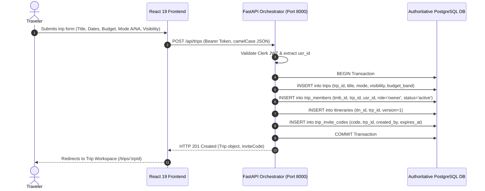
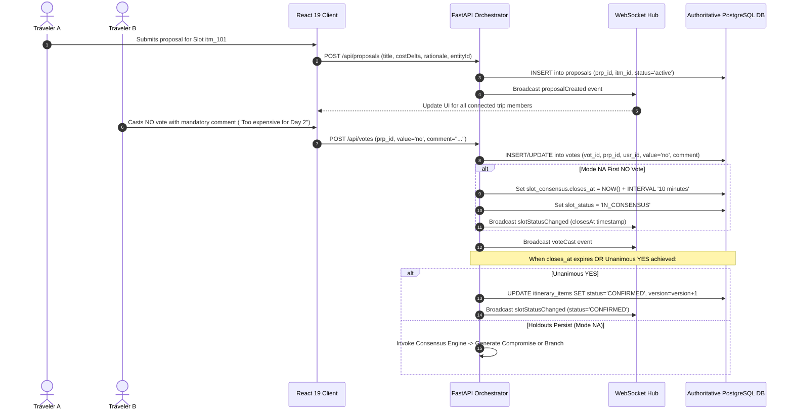
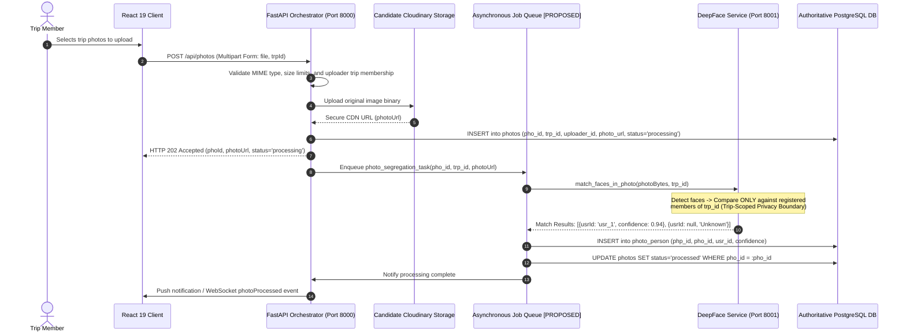
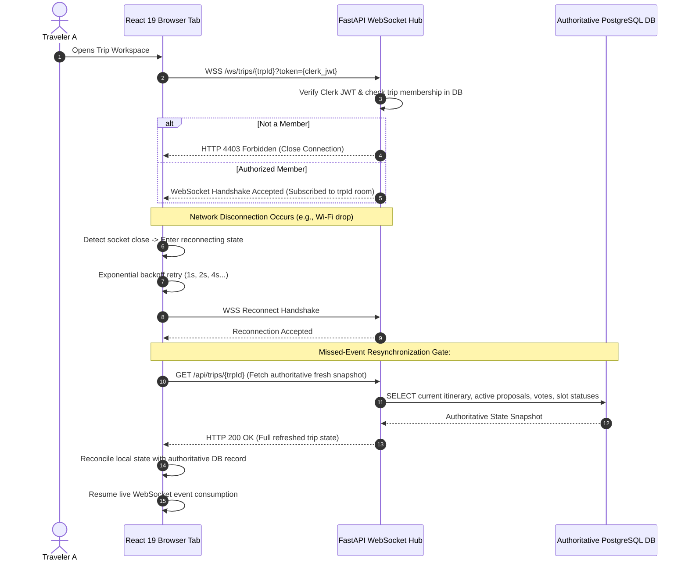

> **HISTORICAL SNAPSHOT — NOT ACTIVE INSTRUCTIONS.** Active team: Nikitha, Panchami and Sharvani only. Current ownership and requirements: [root document](../../../docs/ARCHITECTURE.md) and [shared contract](../../../docs/INTEGRATION_CONTRACT.md). Earlier member assignments in this snapshot are superseded.

# System Architecture Documentation: WanderMatch

**Product**: WanderMatch — Social & Group Travel Planning with an AI Consensus Planner  
**Hackathon**: KogniVera Hackathon 2026 (Problem Statement PS-11, Travel & Tourism Theme)  
**Team**: Chaosminds — Nikitha (Frontend); Panchami (HTTP/WebSocket Transport and DeepFace); Sharvani (Business Logic, AI/Consensus, Authentication, Database, Integration and Deployment)
**Specification Status**: Updated Draft — Complete Tech Stack Documentation Alignment  
**Canonical AI Specification Reference**: For exhaustive Pydantic models, consensus state machine transitions, Promptfoo evaluation configs, and geospatial feasibility formulas, consult the canonical [AI System Specification](AI.md).

---

## 0. Architectural Classification Legend

In strict compliance with repository audit standards, all architectural statements throughout this document are classified under the following governance definitions:

- **`[CURRENT — VERIFIED]`**: Directly observed and confirmed by static inspection of actual repository code, manifests, lockfiles, or entry points.
- **`[CURRENT — PARTIALLY IMPLEMENTED]`**: Relevant code or stubs exist, but end-to-end integration, persistence, or network connectivity is broken, unverified, or mocked.
- **`[TARGET — PROPOSED]`**: Recommended target architecture to be implemented. Not yet deployed or executed in current code.
- **`[DECISION PENDING]`**: Architectural or provider choice that remains open pending empirical benchmarking or explicit stakeholder approval.
- **`[APPROVED REQUIREMENT]`**: Non-negotiable product rule, consensus lifecycle behavior, or mathematical contract approved for WanderMatch.
- **`[VERIFICATION REQUIRED]`**: Operational, security, or deployment claim that cannot be proven by static code analysis alone.

---

## 1. System Topology & Architectural Evolution

WanderMatch is undergoing architectural alignment from an early hackathon multi-entry-point prototype toward a clean, consolidated, production-ready target architecture.

### 1.1 Diagram A — Current Architecture (Verified Source-Level Topology)
`[CURRENT — VERIFIED]` The current repository exhibits service triplication, local data store fragmentation, and several disconnected or stubbed endpoints:

```
┌────────────────────────────────────────────────────────────────────────────────────────┐
│                              CLIENT LAYER (Browser / Mobile)                           │
│     React 19.2.8 + Vite 8.3.0 + Tailwind CSS 4.3.3 + Clerk React 5.61.10 (Port 5173)   │
│     Native fetch in src/lib/api.ts | Native WebSocket in src/lib/api.ts                │
└───────────────────────────────────────────┬────────────────────────────────────────────┘
                                            │ Calls http://localhost:8000
                                            ▼
┌────────────────────────────────────────────────────────────────────────────────────────┐
│ PRIMARY FASTAPI CONSOLIDATED ORCHESTRATOR (`backend/app/main.py` — Port 8000)          │
│ ├── Auth Router (/api/auth/register, /api/auth/login, /api/auth/me)                    │
│ ├── Trips Router (/api/trips, /api/proposals, /api/votes, /api/branches)               │
│ ├── Consensus Router (/api/consensus/proposals, /vote, /reconcile, /branches)         │
│ ├── Matching Router (/api/matching — Solo Traveler Group & Guide Scorer)               │
│ ├── Face Router (/api/face/register, /api/face/match, /api/face/status)                │
│ ├── Photos Router (/api/photos/upload, /api/photos/memories, /api/photos)              │
│ ├── Authenticated WebSocket Hub (/ws/trips/{trip_id} — Clerk JWT & room broadcast)    │
│ └── SQLAlchemy 2.x Session connected to Neon Managed PostgreSQL (`neondb`)            │
│     (Baseline Alembic revision: `c8a6a4789a32` | 24 tables | 34 foreign keys)          │
└───────────────────────┬────────────────────────────────────────┬───────────────────────┘
                        │                                        │
                        │ Direct Model Execution / HTTP Gateway  │ Isolated Worker
                        ▼                                        ▼
┌──────────────────────────────────────────────┐ ┌───────────────────────────────────────┐
│ AI CONSENSUS & VALIDATOR MODULE              │ │ DEEPFACE FACE RECOGNITION SERVICE     │
│ (`backend/app/routers/consensus.py`)         │ │ (`ai/DeepFace/backend/main.py` - 8001)│
│ ├── Mode A (Admin) & Mode NA (Collaborative) │ │ ├── DeepFace + ArcFace Face Matching  │
│ ├── Mandatory Objection Reason Aggregator    │ │ ├── Optional Traveler Facial Enroll   │
│ ├── 10-Minute Timer [DECISION PENDING]       │ │ ├── Local File Storage (ephemeral)    │
│ ├── Deterministic Feasibility Validator      │ │ └── Non-blocking failure policy       │
│ └── Authoritative Neon PostgreSQL Store      │ └───────────────────────────────────────┘
└──────────────────────────────────────────────┘
```

> **Verified Current Architectural Deficiencies**:
> 1. **Triplication of FastAPI Backends**: Three separate entry points exist (`backend/app/main.py`, `ai/AIConsensus/backend/app/main.py`, and `ai/DeepFace/backend/main.py`).
> 2. **Consensus Endpoint Disconnect**: The frontend calls `POST /api/consensus/reconcile` on Port 8000, but that route exists only in `ai/AIConsensus/backend/app/main.py`, producing an immediate HTTP 404 error.
> 3. **In-Memory Consensus Loss**: Active voting rounds, countdown timers, and holdout branches in `AIConsensus` reside in a volatile Python dictionary (`TRIPS_DB = {}`), causing complete state loss upon process restart.
> 4. **Stubbed Services**: `backend/app/routers/photos.py` and `face.py` return static mock JSON rather than persisting records or contacting DeepFace/Cloudinary.
> 5. **Zero Road-Network Routing Code**: No routing integration (OSRM, Mapbox, or Google Routes) exists in code; road feasibility calculations currently exist solely in documentation.
> 6. **Database Fragmentation**: Two distinct SQLite databases exist in the repository (`backend/wandermatch.db` and `deepface/wandermatch.db`) alongside a seed database (`data-model/seed/PS-11.db`), while PostgreSQL connection code is present in `backend/app/database.py`.

---

### 1.2 Diagram B — Proposed Target Architecture (Consolidated Modular Core & Supporting Services)
`[TARGET — PROPOSED]` The target architecture establishes **one authoritative, modular FastAPI backend orchestrator**, **one authoritative PostgreSQL application database**, and isolates **DeepFace as a separate required processing service**:

```
┌────────────────────────────────────────────────────────────────────────────────────────┐
│                              CLIENT LAYER (Browser / Mobile)                           │
│  React 19.2.8 SPA | TypeScript | Vite 8.3.0 | Tailwind CSS 4.3.3 | Clerk React 5.61.10 │
│  Lucide React Icons | React Context (AuthContext, TripContext) | Native fetch & WSS    │
│  Proposed Frontend Tests: Vitest + React Testing Library [DECISION PENDING]            │
└───────────────────────────────────────────┬────────────────────────────────────────────┘
                                            │ HTTPS REST (camelCase) & WSS Events
                                            ▼
┌────────────────────────────────────────────────────────────────────────────────────────┐
│            CONSOLIDATED FASTAPI CORE APPLICATION BACKEND (PORT 8000)                   │
│                       (Python 3.12+ | Uvicorn | Pydantic v2)                           │
│                                                                                        │
│  ┌──────────────────────────────────────────────────────────────────────────────────┐  │
│  │ 15 CLEARLY SEPARATED INTERNAL LOGICAL MODULES:                                   │  │
│  │  1. Auth & Authorization (Clerk JWT, Svix Webhooks, Role-Based Access Control)   │  │
│  │  2. User Profiles & Onboarding (Preferences, Travel Style, Currency, Locale)     │  │
│  │  3. Trip Creation & Management (Public/Private, Dates, Budget, Party Capacity)   │  │
│  │  4. Invitations, Membership & Join Requests (8-Char Codes, Admin Approvals)      │  │
│  │  5. Group & Guide Matchmaking (45% Interest, 35% Language, 20% Age Jaccard)      │  │
│  │  6. Itinerary & Activity Management (Day-Wise Slots, Monotonic Optimistic Lock)  │  │
│  │  7. Proposals & Consensus Voting (YES/NO Binary Votes, Mandatory NO Comments)    │  │
│  │  8. Consensus Rounds, Conflict Resolution & Branches (Mode A & Mode NA Engines)  │  │
│  │  9. AI Planning & Provider Integration (Provider-Independent LLM Adapter)        │  │
│  │ 10. Deterministic Feasibility & Constraint Validator (Road Times, Buffers, Hours)│  │
│  │ 11. Chat & Live Event Distribution (Authenticated WebSocket Hub, Event Contracts)│  │
│  │ 12. Notifications (In-App & Real-Time Alerts)                                    │  │
│  │ 13. Photo & DeepFace Orchestration (Upload Gateway, Biometric Job Dispatcher)    │  │
│  │ 14. Routing, Geocoding & Place Evidence (OSRM Road Engine & Coordinate Lookup)   │  │
│  │ 15. Audit History & Persistence (Immutable 20-Attribute Decision Audit Logs)     │  │
│  └──────────────────────────────────────────────────────────────────────────────────┘  │
└──────┬──────────────────────┬──────────────────────┬────────────────────────────┬──────┘
       │                      │                      │                            │
       │ SQLAlchemy 2.x       │ Internal HTTPS       │ Outbound HTTPS             │ Outbound HTTP
       ▼                      ▼                      ▼                            ▼
┌──────────────┐     ┌────────────────┐    ┌───────────────────┐        ┌────────────────┐
│ AUTHORITATIVE│     │ DEEPFACE PHOTO │    │ AI INFERENCE      │        │ OSRM ROUTING   │
│ APPLICATION  │     │ SERVICE        │    │ PROVIDER [PENDING]│        │ ENGINE [PENDING│
│ DATABASE     │     │ (REQUIRED      │    │ • Hosted LLM API  │        │ • Road Route & │
│ (PostgreSQL) │     │  PROCESSING    │    │   (Gemini 1.5     │        │   Travel Time  │
│ • Single     │     │  SERVICE)      │    │    Flash / Groq / │        │ • Feasibility  │
│   Source of  │     │ • Port 8001    │    │    OpenAI) OR     │        │   Inequality   │
│   Record for │     │ • Isolated     │    │ • Local Ollama    │        │   Validation   │
│   All State  │     │   heavy deps   │    │   (Phi-4 Mini /   │        │ • No Straight- │
│ • Neon is a  │     │   (TF/PyTorch) │    │    Qwen2.5)       │        │   Line Fallback│
│   candidate  │     │ • Async Trip   │    └───────────────────┘        └────────────────┘
│   managed    │     │   Member Face  │              │                               │
│   provider   │     │   Matching     │              │ Outbound HTTPS                │
│   [PENDING]  │     │ • Non-blocking │              ▼                               │
└──────────────┘     │   failure mode │    ┌───────────────────┐                     │
       ▲             └────────────────┘    │ CLOUDINARY CDN    │                     │
       │                      ▲            │ [PENDING]         │                     │
       │                      │            │ • Media Storage   │                     │
       │                      │            │ • Secure Delivery │                     │
       │                      │            └───────────────────┘                     │
       │                      │                                                      │
┌──────┴──────────────────────┴──────────────────────────────────────────────────────┴───┐
│ PROPOSED BACKGROUND PROCESSING & LIVE EVENT SCALING [DECISION PENDING]                 │
│ • Durable Job Queue & Worker (Technology Open: Redis Queue / Celery / Dramatiq / ARQ)   │
│ • Shared Event Distribution: Redis Pub/Sub (Conditional candidate if multi-instance)  │
└────────────────────────────────────────────────────────────────────────────────────────┘
```

---

## 1.4 Phase 2 Verified Status, Operational Holds & Pending Decisions
- **`[CONFIRMED SYSTEM OF RECORD]`**: Neon Managed PostgreSQL (`neondb` on AWS ap-southeast-1) is the single authoritative system of record, stamped at Alembic revision `c8a6a4789a32`.
- **`[CURRENT — VERIFIED]` Real-Time Hub**: In-process `ConnectionManager` handles trip-scoped WebSocket broadcasts on Port 8000. Redis pub/sub broker is currently unconfigured and represents a scaling target for multi-instance deployments.
- **`[CURRENT — VERIFIED]` Photo Storage**: Uploads currently write to `backend/static/uploads/` on local disk. On Render containers, this filesystem is ephemeral. Cloudinary configuration is an unresolved production deployment prerequisite.
- **`[DECISION PENDING: Product Sign-Off Required]` Mode NA 10-Minute Timer**: The 10-minute countdown initiated after the first NO vote is implemented in code (`closes_at = first_no_at + 10m`). Product sign-off is pending to determine whether 10 minutes is an immutable canonical requirement or trip-configurable.
- **`[DEFERRED_FOLLOW_UP]` Slow Navbar/Page Navigation**: User-observed latency when switching tabs/pages in the navbar is deferred for empirical profiling; no speculative optimizations or architectural changes.
- **`[CLEANUP_ON_HOLD]` Database Cleanup**: Cleanup of 27,283 historical transactional records across 19 tables in Neon PostgreSQL is strictly on hold until all planning phases complete.

## 2. Diagram C — Key End-to-End Data Flows

### 2.1 Flow 1: Trip Creation, Privacy & Membership Persistence
`[TARGET — PROPOSED]`


---

### 2.2 Flow 2: Proposal Creation, Binary Voting, Consensus & Confirmation
`[APPROVED REQUIREMENT]`


---

### 2.3 Flow 3: AI Plan Generation, Deterministic Constraint Validation & Repair
`[APPROVED REQUIREMENT]`
```mermaid
sequenceDiagram
    autonumber
    participant Engine as Consensus Engine Module
    participant LLM as Provider-Independent AI Adapter
    participant Val as Deterministic Constraint Validator
    participant Routing as OSRM Road Routing Engine
    participant DB as Authoritative PostgreSQL DB

    Engine->>LLM: generate_blended_plan(group_preferences, active_objections, trip_budget)
    LLM-->>Engine: Raw Candidate Plan (JSON: title, activity_duration, cost_delta, entity_id)
    
    Engine->>Val: validate_plan(candidate_plan, slot_window, trip_constraints)
    Val->>Routing: GET /route/v1/driving/{coords_origin};{coords_venue}
    Routing-->>Val: Road Duration t_arr (minutes, not straight-line!)
    Val->>Routing: GET /route/v1/driving/{coords_venue};{coords_return}
    Routing-->>Val: Road Duration t_ret (minutes)
    
    Val->>Val: Check Feasibility: t_arr + t_act + t_ret + 2*t_buf <= W_avail
    Val->>Val: Check Operating Hours & Budget: cost_delta <= budget_tolerance

    alt Plan Passes All Constraints
        Val-->>Engine: Validation Result: VALID (Feasible)
        Engine->>DB: Commit Candidate Plan or Advisory Recommendation
    else Constraint Violated (e.g., travel time exceeds window)
        Val-->>Engine: Validation Result: INFEASIBLE (Violations logged)
        alt Retry Bounded (attempt < 2)
            Engine->>LLM: Re-prompt with specific feasibility violation feedback
        else Exhausted / Hard Incompatibility
            Engine->>Engine: Escalate to Parallel Branching (Track A / Track B)
        end
    end
```

---

### 2.4 Flow 4: Photo Upload, Storage, Asynchronous Biometric Segregation
`[APPROVED REQUIREMENT]`


---

### 2.5 Flow 5: Live Event Delivery, Authorization, Reconnection & Resynchronization
`[APPROVED REQUIREMENT]`


---

### 2.6 Flow 6: Itinerary PDF Export Pipeline
`[APPROVED_REQUIREMENT]`
```
User (Browser)
   | 1. Click "Download Itinerary as PDF"
   v
Client UI (ResolvedItineraryScreen)
   | 2. Request Authoritative Itinerary Payload (with Clerk JWT)
   v
FastAPI Gateway (`backend/app/routers/trips.py`)
   | 3. Authenticate JWT & Validate Trip Membership
   | 4. Query Neon PostgreSQL (`itineraries`, `itinerary_items`, `trips`)
   | 5. Return authoritative JSON or Stream Rendered PDF (Decision #30)
   v
PDF Formatting & Layout Engine
   | 6. Format Multi-Day Schedule, Page Breaks, and Status Watermark
   v
Client Download (File: WanderMatch_{trip_title}_v{version}.pdf)
```

### 2.7 Flow 7: AI Accountability & Audit Traceability Boundary
`[APPROVED_REQUIREMENT]`
```
Consensus Trigger / Admin Action
   v
AI Consensus Engine (`ai/AIConsensus/`) [Advisory Only]
   | 1. Generates Structured Compromise Candidate
   v
Deterministic Backend Validator (`hard_constraint_validator.py`)
   | 2. Checks entity types, cost format, travel feasibility
   v
Authorization & State Manager (`backend/app/routers/consensus.py`)
   | 3. Authoritative State Transition (SlotConsensus updated)
   | 4. Append-Only Revision Logged (`revision_history`)
   v
PostgreSQL System of Record (Neon Managed DB)
```

## 3. Core Backend Modular Architecture (15 Modules)

`[TARGET — PROPOSED]` In the target architecture, the core backend is consolidated into a single FastAPI service structured into 15 logical modules with explicit responsibilities:

| # | Logical Module | Key Responsibilities | Primary Data Entities Owned |
| :---: | :--- | :--- | :--- |
| **1** | **Authentication & Authorization** | Clerk JWT verification, JWKS caching, Svix webhook processing, role-based trip access control. | `users`, session tokens, permissions |
| **2** | **User Profiles & Onboarding** | Profile setup, travel preferences, budget classes, currency (ISO-4217), languages (BCP-47). | `users`, `user_preferences` |
| **3** | **Trip Creation & Management** | Trip lifecycle, public/private visibility, destination cities, date ranges, party size caps. | `trips`, `trip_members` |
| **4** | **Invitations, Membership & Join** | 8-character invite code lifecycle, join requests, owner approval workflows, capacity checks. | `trip_invite_codes`, `join_requests` |
| **5** | **Group & Guide Matchmaking** | Solo traveler compatibility scoring (45% interest, 35% language, 20% age Jaccard); guide matching. | Compatibility cache, candidate pools |
| **6** | **Itinerary & Activity Management** | Day-wise activity slots, venue details, timing, optimistic concurrency via monotonic `version`. | `itineraries`, `itinerary_items` |
| **7** | **Proposals & Consensus Voting** | Slot proposal submission, binary YES/NO vote casting, mandatory comment enforcement on NO. | `proposals`, `votes` |
| **8** | **Consensus Rounds & Branches** | Mode A (admin-led) and Mode NA (collaborative) state machines, 10-minute timers, parallel branches. | `slot_consensus`, `branches`, `branch_members` |
| **9** | **AI Planning & Provider Adapter** | Provider-independent LLM calling (OpenAI SDK wrapper), prompt assembly, structured output validation. | Prompt templates, generation sessions |
| **10**| **Deterministic Constraint Validator**| Non-negotiable business rules gate: road-network travel feasibility, operating hours, budget limits. | Validation logs, feasibility cache |
| **11**| **Chat & Live Event Distribution** | Trip-scoped group messaging, authenticated WebSocket connection hub, canonical event delivery. | `trip_chat_messages`, socket registries |
| **12**| **Notifications** | In-app alerts for vote deadlines, join requests, branch confirmations, admin actions. | Notification queues, client toasts |
| **13**| **Photo & DeepFace Orchestration** | Photo upload gateway, Cloudinary CDN dispatch, trip-scoped face recognition job coordination. | `photos`, `photo_person`, `face_profiles` |
| **14**| **Routing, Geocoding & Place Evidence**| Road travel duration calculation (OSRM engine), venue coordinate lookup, opening hours evidence. | Route logs, place evidence cache |
| **15**| **Audit History & Persistence** | Immutable 20-attribute AI decision audit trail, slot revision snapshots, transactional reversions. | `revision_history`, `consensus_audit_logs` |

---

## 4. DeepFace Photo Segregation Architecture

`[APPROVED REQUIREMENT]` **Photo segregation is a required WanderMatch capability. It must never be removed, downgraded to an optional future feature, or replaced with an unrelated framework.**

1. **Service Boundary Isolation**:
   - DeepFace runs as a separate processing service (Port 8001 in development; isolated worker container in target deployment) because its dependencies (TensorFlow/PyTorch, OpenCV, DeepFace) and computational demands (GPU/heavy CPU embedding generation) would severely degrade the core API orchestrator.
2. **Trip-Scoped Privacy Boundary**:
   - Face matching is **strictly trip-scoped**. DeepFace queries reference embeddings **only** for registered members of the specific trip (`trp_id`). It never matches against a global or cross-trip face database.
3. **Traveler Enrollment vs. Capability Requirement**:
   - For an individual traveler, reference photo enrollment is **optional** (travelers may opt out of biometric tagging).
   - For the WanderMatch application, the **photo segregation capability itself is required**.
4. **Graceful Degradation & Non-Blocking Resilience**:
   - Biometric processing failures, timeouts, or un-enrolled members must **never** block photo uploading, itinerary planning, voting, or consensus resolution. Unmatched faces are safely tagged as `Unknown` (`usr_id = NULL`).
5. **Implementation Settings vs. Final Decisions**:
   - The current repository configures ArcFace and OpenCV. These represent existing implementation settings, not finalized architecture choices. Exact embedding dimensions, similarity thresholds, and detector configurations remain subject to empirical evaluation.

---

## 5. Technology Stack Summary & Target Baseline

| Layer | Verified Current Implementation | Target Proposed Architecture | Decision Status |
| :--- | :--- | :--- | :--- |
| **Frontend Framework** | React 19.2.8, Vite 8.3.0, TypeScript ~6.0.2 | React 19.2.8, Vite 8.3.0, TypeScript | `[CURRENT — VERIFIED]` |
| **Frontend Styling** | Tailwind CSS 4.3.3 (`@tailwindcss/vite`) | Tailwind CSS 4.3.3 | `[CURRENT — VERIFIED]` |
| **Frontend Routing** | React Router DOM 7.18.4 | React Router DOM 7.18.4 | `[CURRENT — VERIFIED]` |
| **Frontend Auth Client** | `@clerk/clerk-react` 5.61.10 | `@clerk/clerk-react` 5.61.10 | `[CURRENT — VERIFIED]` |
| **Frontend State** | React Context (`AuthContext`, `TripContext`) | Modularized React Context / Hooks | `[CURRENT — VERIFIED]` |
| **Frontend Testing** | None installed | Vitest + React Testing Library | `[TARGET — PROPOSED]` |
| **Backend Core** | FastAPI >=0.111.0, Uvicorn, Python 3.12/3.14 | Consolidated FastAPI Modular Backend on Port 8000 | `[CURRENT — VERIFIED]` |
| **Backend Data Layer** | SQLAlchemy >=2.0.30, Alembic baseline `c8a6a4789a32` | SQLAlchemy 2.x, Alembic Migrations | `[CURRENT — VERIFIED]` |
| **Application Database**| Neon Managed PostgreSQL (AWS ap-southeast-1, PostgreSQL 18.6) | Single Authoritative PostgreSQL DB (24 tables, 34 FKs) | `[CURRENT — VERIFIED]` |
| **Database Hosting** | Neon Managed PostgreSQL (`neondb`) | Neon Managed PostgreSQL `[CONFIRMED SYSTEM OF RECORD]` | `[CURRENT — VERIFIED]` |
| **Consensus Engine** | Consolidated router (`backend/app/routers/consensus.py`) | Consolidated Internal Module on Port 8000 | `[CURRENT — VERIFIED]` |
| **AI Inference** | OpenAI SDK wrapper (Gemini, Groq, Ollama fallbacks) | Provider-Independent Adapter (Local/Hosted) | `[DECISION PENDING]` |
| **Deterministic Validator**| Prototype validator in AIConsensus + feasibility router | Road-Network Feasibility Validator | `[CURRENT — PARTIALLY IMPLEMENTED]` |
| **Road Routing Engine** | None (0 lines of code; Haversine prohibited) | OSRM Engine (Self-Hosted / Docker) | `[DECISION PENDING]` |
| **Geocoding Provider** | None in code | OpenStreetMap Nominatim / Mapbox | `[DECISION PENDING]` |
| **Biometrics Service** | DeepFace (ArcFace, Port 8001, local file persistence) | Required Separate Processing Service (Non-blocking) | `[APPROVED REQUIREMENT]` |
| **Media Storage** | Photo router uploads to `static/uploads/`; Cloudinary unconfigured | Cloudinary Media CDN / S3 persistent storage | `[TARGET — UNCONFIGURED]` |
| **Live Collaboration** | In-process authenticated WebSocket room hub on Port 8000 | Authenticated Multi-User WebSocket Hub (Redis for scale) | `[CURRENT — VERIFIED]` |
| **Background Processing**| Synchronous / inline processing | Durable Queue & Worker (Redis Queue/ARQ)| `[TARGET — PROPOSED]` |
| **CI / CD & Containers** | None found in repository | GitHub Actions + Docker Containers | `[TARGET — PROPOSED]` |

---

## 6. Restart & Failure Recovery Contracts

1. **Process Restarts & State Continuity**:
   - Active countdown timers must be persisted as absolute UTC timestamps (`first_no_at`, `slot_consensus.closes_at`) in PostgreSQL. The physical column `proposals.closes_at` is strictly a read-only mirror.
   - Upon process restart, the orchestrator or background worker reloads active deadlines from the database, preventing timer loss.
2. **AI Provider Failure & Timeout Protocol**:
   - LLM API calls are capped with a bounded timeout (recommended 10s operational limit).
   - If the LLM provider fails, times out, or produces invalid JSON, the orchestrator triggers bounded retries before safely escalating to parallel branching. In no case may an AI failure turn a fabricated fallback into an accepted itinerary.
3. **WebSocket Disconnect & Resynchronization**:
   - WebSocket connections are ephemeral.
   - Upon reconnection, the React frontend must execute a full state refresh (`GET /api/trips/{trpId}`) against the authoritative PostgreSQL database before consuming new real-time events.
4. **Optimistic Concurrency Conflict Recovery**:
   - Itinerary updates enforce monotonic version checking (`WHERE itn_id = :itn_id AND version = :expected_version`). If zero rows are updated, the transaction rolls back, returning HTTP 409 Conflict so the client can reload and reapply changes.
